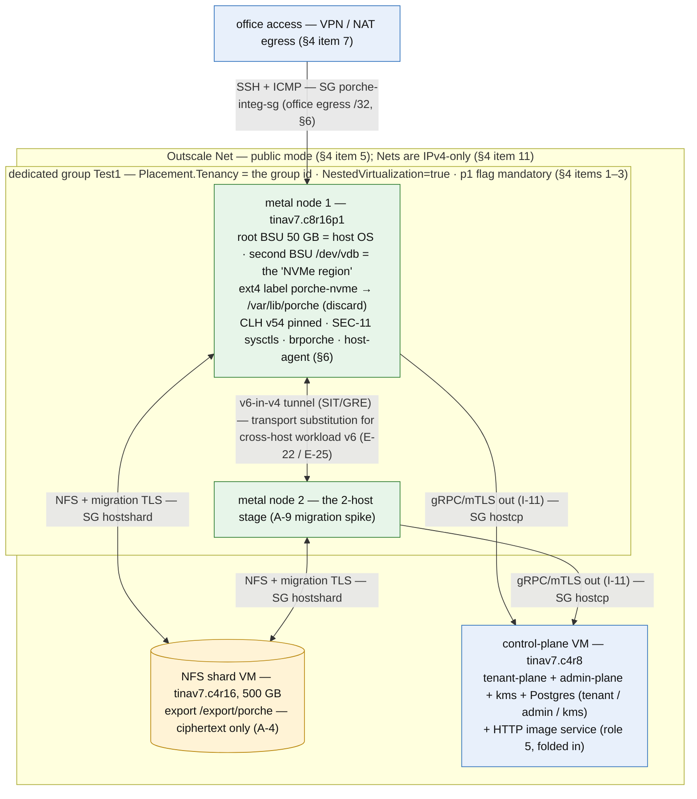

# 13 — Integration Environment (Outscale cloud)

Working document — v6, 2026-10-19. Defines and records the **integration environment**:
PORCHE's "proper infra" simulated on Outscale cloud VMs, used for test and integration
**before and alongside** the bare-metal PoC. This document is the contract between that
environment and the design corpus: what it validates, what it deliberately never
validates, how it is built, and how it is operated.
**v2 (E-16/E-18)**: the PoC itself executes here — metal keeps every performance and
security gate; "functionally" for the escape suite made explicit (baseline-delta method).
**v3 (E-22/E-25)**: IPv6-first — cross-host v6 validated here over a **v6-in-v4 tunnel**
(transport substitution); native v6 fabric = metal-only. Outscale Nets recorded as
IPv4-only. **v4**: FCOS sequencing clarified — stock stable OMI = the PoC host base
(recorded run), lean derivative = action 13 (P0); §8 pointer fixed (was mis-aimed at
action 11). **v5**: 2026-10-19 cost pause — node 1 stopped (environment preserved on
its root BSU), empty BSUs deleted, public IPs kept (operator); node-2 TF drift
reconciled.

**v6** (figures pass): topology figure added (Fig. 13.1) — informative, the prose stays
normative.

Related: doc 07 (the PoC — **executes here**, E-16; perf and security evidence stays on
metal), doc 12 (software architecture validated here), doc 08 A-1/A-9 (the spikes hosted
here).

---

## 1. Position

- The integration environment exists to validate **mechanism** — protocol, orchestration,
  state machines, storage stacks, migration — cheaply and repeatably.
- The **PoC (doc 07) executes here** (E-16): direct-CLH buildability, tier-E attach/wipe,
  and teardown determinism — the *functional* kill criteria are judged in this environment.
- **Performance and security evidence** (PERF-1/5/8, residual-memory probe, escape-suite
  security claims) is measured on **real bare metal** — the metal validation run (E-16) —
  and never here.
- A number measured in this environment is a smoke test; a gate passed only here has not
  passed.

## 2. Fidelity contract

**Validated here (functional, fully):**

| What | Corresponding design element |
|---|---|
| Host-agent ↔ control-plane protocol (gRPC/mTLS, dual channel, desired-state reconciliation) | doc 12 §3/§6, I-11/I-12, E-8 rule 1 |
| Three services + Postgres, plane separation, two API surfaces | doc 12, E-8, FR-40/SEC-24 |
| CLH orchestration: create/boot/stop/wipe, teardown determinism, 1,000× loop | E-4, FR-3, PERF-8 *function* |
| Tier-E LUKS2 volume on a block device, dm-crypt attach, crypto-erase teardown | I-2, E-6 |
| **A-1 spike**: dm-writecache/dm-era sealable tier-R stack (seal → ship → restore) | doc 04 §3, A-1 gate |
| **A-9 spike**: CLH live migration between two nodes over TLS, KMS lease extension, cutover state machine, checkpoint fallback | FR-34, E-3, doc 12 §6 |
| Epoch shipping, `SyncVolume` seals, restore from checkpoint, storage-worker clone | doc 04 |
| Escape suite "must fail" runs (E-7) — functionally; kernel hardening applies inside the node. "Functionally" = the harness runs and the PoCs exercise the intended surface; **no security claim is inferred** — the baseline-delta evidence (E-18) is metal-only | SEC-40/SEC-11 |
| Cross-host IPv6 workload routing — **over v6-in-v4 (SIT/GRE) as a transport substitution**; netns/bridge/nft/proxy mechanics are the real ones | doc 14 §3, E-22/E-25 |
| Teardown + relaunch loops, wedge detection | doc 01 §8 criteria 6 |

**Never validated here (metal only):**

| What | Why it cannot transfer |
|---|---|
| PERF-1/2/5/9/10 absolute numbers | nested KVM inflates boot and I/O; BSU "local" storage is network-backed |
| Tier-E vs tier-R performance ratio and economics (doc 04 §2.1) | real NVMe is 10–50× faster than the NFS path; here both tiers are network — the ratio is distorted |
| Bare-metal security assertions (residual-memory probe as *evidence*) | the outer hypervisor is Outscale's; the threat model assumes we own the metal |
| L2/VLAN control (F45 class), IOMMU/VFIO, GPU | no L2 access, no VT-d passthrough in cloud VMs |
| Netboot/reimage (doc 10) | no PXE; approximated by image swap or rpm-ostree — drain/attest/wipe *logic* still exercised |
| PERF-13 migration pause absolute value | measured, but as a smoke signal only |
| Native IPv6 workload fabric | Outscale Nets are RFC1918 v4-only (§4 item 11); v6 exists here only over the tunnel substitution — native-v6-fabric behavior is metal-only |

## 3. Topology

Five roles; only the metal nodes need dedicated tenancy and nested virtualization.

| # | PORCHE element | Outscale realization | Size (initial) |
|---|---|---|---|
| 1–2 | bare metal hosts | dedicated-group VM, `NestedVirtualization=true`, **p1 performance flag required**, tenancy = the group ID | `tinav7.c8r16p1`, root BSU 50 GB |
| 1–2 | local NVMe (tier E/R hot path) | **second BSU volume** per metal VM (`/dev/vdb`) — root disk is "host OS", second volume is the "NVMe region" | 100–200 GB gp2/io2 |
| 3 | NFS storage pool / hot shard | normal-tenancy VM + large BSU, NFS export (`/export/porche`); ciphertext only (A-4 — placement non-security-critical by design) | `tinav7.c4r16`, 500 GB gp2 |
| 4 | control plane | normal-tenancy VM: `porche tenant-plane` + `admin-plane` + `kms` + Postgres (single node; HA is a separate drill, A-8) | `tinav7.c4r8` |
| 5 | netboot/image service | folded into #4 initially (HTTP); PXE approximated — §2 | — |

**Both metal nodes land on the same physical server of the dedicated group** — cross-VM
live migration between them is a genuine VMM-level migration.

**Network**: metal nodes in **public mode** (see §4, the Net-tenancy subtlety);
segmentation expressed with security groups — one SG for management (SSH/ICMP from the
office), one for host↔control-plane (gRPC/mTLS), one for host↔shard (NFS + migration TLS
port). The FR-30 storage-network reservation is host-side `tc` shaping on the metal nodes —
testable here as-is.

**Fig. 13.1 — Integration environment topology (§3–§5, Outscale `eu-west-2a`).** The cloud
nodes emulate the metal layout; every perf and security *gate* stays metal-only (§2).



## 4. Outscale mechanics (learned — reproduce exactly)

Region `eu-west-2`; subregion `eu-west-2a`. Credentials: local `~/.osc/config.json`
(never in this document or the repository).

1. **Dedicated groups are the tenancy**: `CreateVms` with `Placement.Tenancy = <group-id>`
   (e.g. `ded-53c8318b`) — not `dedicated`, and there is no separate group parameter.
2. **The `p1` performance flag is mandatory in dedicated groups** (`tinavW.cXrYp1`);
   `p2`/`p3` are rejected there.
3. **Nested virtualization** is a `CreateVms` flag: `NestedVirtualization=true`. Result:
   `vmx` CPU flag + `/dev/kvm` + `kvm_intel nested=Y` inside the VM. Verified on gen-7
   (Xeon Sapphire Rapids) with CLH v54.0 booting a guest kernel.
4. **Subregion goes inside `Placement`** (`Placement.SubregionName`), not top-level.
5. **A Net (VPC) must itself carry the dedicated group as tenancy** to host
   dedicated-group VMs — and that would pull *all* its VMs onto dedicated servers.
   Hence public mode for metal nodes (SG-segmented) until proven otherwise.
6. **SSH user on Rocky OMIs is `outscale`** (not `rocky`/`cloud-user`).
7. **Office access path**: via VPN/NAT — egress seen by the cloud as `46.231.147.8`
   (~0.4 ms RTT; fully workable for the migration spike). Direct egress is `171.33.98.94`.
8. Public IPs are allocated and linked explicitly (`CreatePublicIp` + `LinkPublicIp`).
9. CLH v54 CLI: `--cpus boot=N`, `--memory size=NM` — first thing the host-agent encodes.
10. **CLI = `octl`** (v0.0.34, static Go binary, Sigstore-verified at install; successor of
    the legacy `osc-cli`): `octl iaas api <Operation> --profile sandbox`, typed flags.
    Two lessons: the legacy `osc-cli` passed CLI strings through verbatim, so
    `--NestedVirtualization true` sent string `"true"` and the API rejected it with 4110 —
    a Python SDK shim (`bin/osc-api.py`) existed just for that, now deleted because octl's
    flags are typed. And **only the `sandbox` profile of `~/.osc/config.json` is ever used**
    (the file holds two profiles; the other is out of bounds for this project).
11. **Nets are IPv4-only**: a Net's CIDR must be RFC1918 (/16–/28), public IPs are v4
    (`CreatePublicIp`/`LinkPublicIp`), and there is no v6 Net option. Consequence
    (E-22/E-25): cross-host workload v6 rides a **v6-in-v4 tunnel** here — a transport
    substitution per §2's fidelity contract — and native v6 fabric is a metal-only claim.
    Attached-IPv4 mechanics (E-24) map 1:1 onto Outscale public IPs and validate here.
12. **Keypair injection can serve a stale key** (2026-10-19): `c8r16p1` VMs created
    with `KeypairName=porche-integ2` (metadata confirmed it) had the **old
    `porche-integ` key** injected in `authorized_keys` — while a `c2r2p1` VM created
    with the identical flag got the right key (host-level cache reuse suspected).
    **Workaround (now the rule)**: pass the key via `--UserData` cloud-config
    (`ssh_authorized_keys:`), which bypasses keypair injection entirely, and **verify
    the authorized key in the console output** (`ReadConsoleOutput` → cloud-init's
    authorized-keys table) before trusting SSH.
13. **`StartVms` on a stopped group VM can 504-loop** (2026-10-19): four attempts,
    all gateway timeouts, VM never reallocated (a `c2r2p1` creation in the same
    group booted in 20 s — capacity was fine). VMs **boot reliably at creation**;
    a **guest reboot** (`systemctl reboot`) retains the physical server. Rule: never
    stop the node mid-burst; teardown = stop (accepting recreation cost) — the node
    is reproducible in ~5 min (`harness/node-setup.sh` + bundle; recipe removed at the
    2026-10-20 rollback (E-29); rebuilt by MS-1's node step).
14. **TF applies touching VM-linked resources were unreliable during the 2026-10-19
    burst** (one stopped the node despite `env_running=true`; link applies hung).
    The working links were made directly via `octl` (`LinkVolume`, `LinkPublicIp`).
    TF state holds the current records; reconcile with the documented
    out-of-band-then-import pattern before the next TF use.
15. **Capacity fallback ladder (operator, E-31.1, 2026-10-20)**: if `tinav7.c8r16p1`
    allocation is a bottleneck (§4.13's 504-loops, group exhaustion), try
    **tinav5/v6/v7 alternatives before blocking** — the PoC bets pin dedicated
    tenancy + nested virtualization (§5), not the exact metal type. Record any
    substitution in the run's fixtures (type, tenancy, nested-virt verified).

## 5. Provisioning recipe (reproducible)

```text
prereq:  keypair "porche-integ" (imported local public key)
         SG "porche-integ-sg"   (SSH+ICMP: office egress ranges)

metal ×2:
  CreateVms  ImageId=<Rocky-9 OMI>            # placeholder until the FCOS OMI exists
             VmType=tinav7.c8r16p1
             KeypairName=porche-integ
             NestedVirtualization=true
             SecurityGroupIds=[porche-integ-sg]
             Placement={Tenancy: ded-53c8318b, SubregionName: eu-west-2a}
             BlockDeviceMappings=[root 50 GB]
  CreateVolume 200 GB → LinkVolume as /dev/vdb     # the "NVMe region"
  CreatePublicIp → LinkPublicIp

storage:
  CreateVms  VmType=tinav7.c4r16 (normal tenancy), 500 GB BSU
             → NFS server, export /export/porche (ciphertext only)

control plane:
  CreateVms  VmType=tinav7.c4r8 (normal tenancy)
             → Postgres (databases tenant/admin/kms), porche services, HTTP image svc
```

## 6. Current state (2026-10-19, post-burst)

| Resource | ID | Status |
|---|---|---|
| Dedicated group `Test1` | `ded-53c8318b` (eu-west-2a, gen 7) | pre-existing, in use |
| Metal node 1 | `i-b48c9483` (`tinav7.c8r16p1`, nested virt, keypair `porche-integ2`, key injected via UserData — §4.12) | **PoC-ready**, stopped at burst end (§4.13: recreation = `harness/node-setup.sh` + bundle, ~5 min; recipe removed at the 2026-10-20 rollback (E-29); rebuilt by MS-1's node step) |
| Node 1 public IP | `eipalloc-84925ae5` (`148.253.126.10`) | linked to `i-b48c9483` (via octl) |
| Node 1 second BSU | `vol-ad0f8082` (200 GB gp2) | linked (via octl); ext4 `porche-nvme` label, mounted `/var/lib/porche` with discard — the tier-E volume region |
| SG `porche-integ-sg` | `sg-ba94b9e2` | SSH rule **extended**: `171.33.93.229/32` (current office egress, 2026-10-19) |
| Keypair | `porche-integ2` (local `~/.ssh/porche_integ`) | active; the old `porche-integ` key is **lost** (private key not found — root cause of the 2026-10-19 node recreation) |
| SGs `hostcp` / `hostshard` | `sg-6145a812` / `sg-63985462` | deployed |
| Public IPs (node 2 / NFS / CP) | `eipalloc-7df5877e` / `eipalloc-64230109` / `eipalloc-37f28ba3` | allocated, unlinked |
| Metal node 2 | — | not recreated (2-host stage) |
| NFS VM, control-plane VM | — | not provisioned (recipe §5) |
| Canary VM | `i-b57d5cda` (`tinav7.c2r2p1`) | **deleted** 2026-10-19 (allocation probe — §4.13) |

Node 1 PoC state (all applied by `harness/node-setup.sh`; recipe removed at the
2026-10-20 rollback (E-29); rebuilt by MS-1's node step): CLH v54.0
(sha256-pinned), SEC-11 sysctls asserted, modules `bridge/veth/nf_tables/dm_mod/
dm_crypt/loop/tun` warmed and verified before `modules_disabled=1`, `brporche`
bridge, platform image + specs under `/root/poc/`, host-agent at
`/usr/local/bin/porche`. **First full PoC cycle green on this node** (doc 07
§8.5): create → `porche.ready` → `porche.done` → poweroff → wipe all-pass;
5-cycle loop stable (`runs/20261019-1201-miniloop/`).

## 7. Operations

- Access: `ssh outscale@<public-ip>` with the local key.
- Cost control: dedicated servers are allocated while group VMs run — **stop or
  terminate metal VMs when idle**; a stopped VM releases the physical server back
  (re-allocation happens on next start).
- Teardown: `DeleteVms` + `DeletePublicIp` + `DeleteVolume` per resource; the group
  (`Test1`) and SG/keypair stay.
- This environment is **not** a security boundary: test workloads only, mock KMS (local
  key file per doc 07) until the real KMS service lands here (doc 12).

## 8. Open items

- [x] Provision second BSUs + host SGs (`hostcp`/`hostshard`) + public IPs (2026-10-18,
      via the repository's `infra/integration/`). *2026-10-19 clearing: both BSUs
      deleted (cost pause, never used); the public IPs stay allocated. `tofu apply`
      re-creates the volumes as `+` lines when needed.*
- [x] Metal node 2 — **cleared 2026-10-19**: the out-of-band termination (2026-10-18) is
      reconciled out of the TF state (dead VM + volume/link records removed); not
      needed until the 2-host stage (A-9 spike), then recreated per §5.
- [ ] Provision the NFS VM + control-plane VM (§5) — SGs and public IPs exist; VM
      creation pending.
- [ ] FCOS derivative OMI (import qcow2 → OMI; Ignition via user-data — verify metadata
      compatibility; fallback: bake config into the OMI). Unblocks the **E-5 PoC host
      base** (doc 07 §2/§7.1 — the recorded PoC run lands here) and action 13's
      production image.
- [ ] SG set for host↔control-plane and host↔shard flows (gRPC, NFS, migration TLS port).
- [ ] Net-tenancy question: verify whether a dedicated-group Net can host default-tenancy
      VMs (if yes, migrate topology off public mode for cleaner segmentation).
- [ ] Decide the tc shaping profile simulating FR-30 storage-network reservations.
- [ ] v6-in-v4 tunnel profile between nodes (SIT/GRE — E-22/E-25): mechanism choice,
      addressing of the tunnel endpoints, and how it composes with the tc shaping above.
